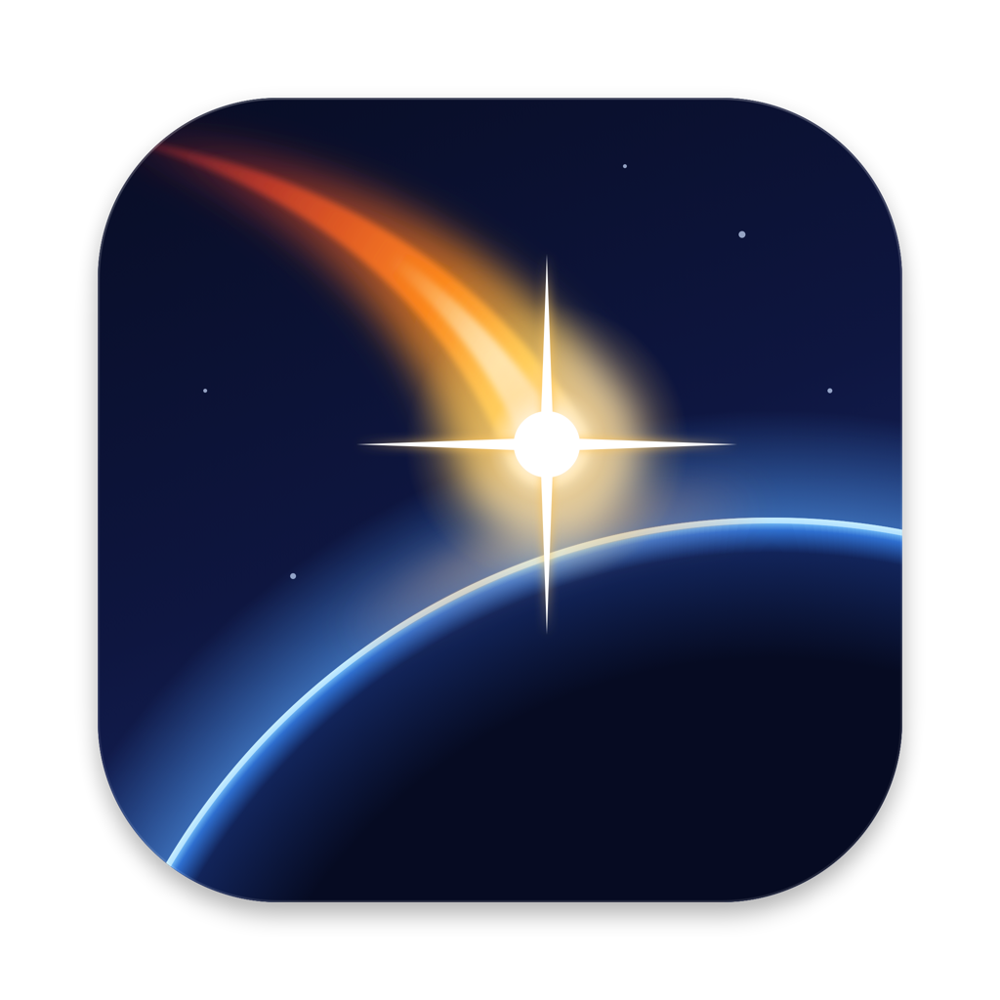
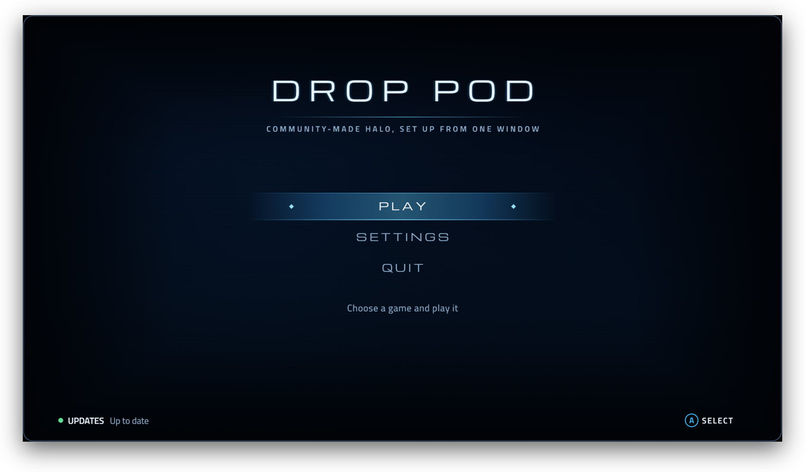
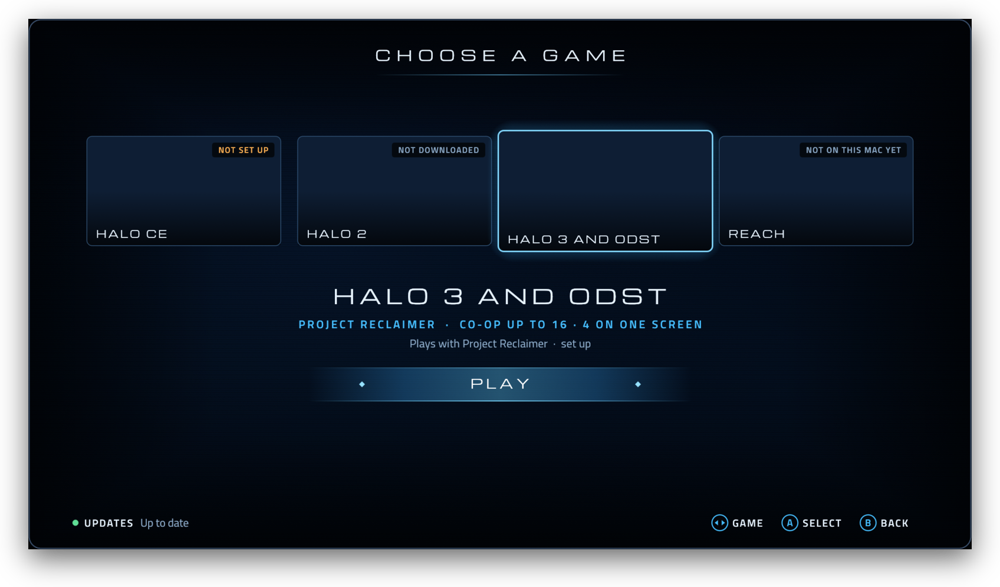
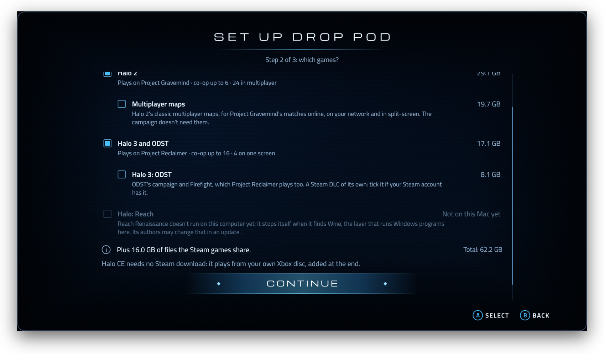
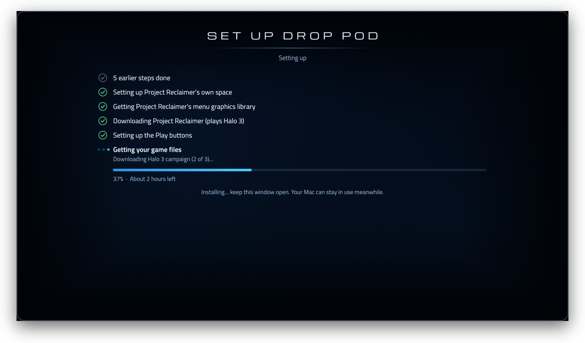

<h1 align="center">Drop Pod</h1>

<b>Community-made Halo, set up from one window.</b> 
macOS · Windows · Linux &nbsp;·&nbsp; free and open source (GPL-3.0)

Screenshots shown without game art. In the app, each game's tile and the menu backgrounds show
MCC's own artwork, read from your Master Chief Collection game files once Drop Pod finds or downloads them.

Drop Pod finds, installs and launches the fan projects that run Halo 2, Halo 3, ODST and Reach from **your own Steam
copy of Halo: The Master Chief Collection**, and the native port of the original Xbox Halo from **your own disc**.
No Terminal, no hunting for downloads: pick your games, scan a QR code with Steam on your phone, press Play. Each
project downloads from its own releases and keeps itself updated. Drop Pod never includes game files.

## The games

| Game | Plays with |
|---|---|
| Halo: Combat Evolved | **[ChupathingyCE](https://github.com/ChupathingyCE/chupathingyce)**, a native port of the Halo: CE decompilation for Windows, Mac, Linux (Steam Deck too) and Android: the campaign with online co-op, split-screen, System Link, and online games with a server browser |
| Halo 2 | **[Project Gravemind](https://briroz1.github.io/project-gravemind/)**: co-op campaign for up to 6, multiplayer for up to 24 with matchmaking, ranked playlists, parties and a game browser, dedicated servers, split-screen, and Steam Workshop mods downloaded as you join |
| Halo 3 and ODST | **[Project Reclaimer](https://github.com/ProjectReclaimer/project-reclaimer-releases)**, with its own menus: co-op campaign for up to 16 (up to 4 in split-screen on one computer), multiplayer for up to 128 with dedicated servers and a server browser, Forge, and ODST's Firefight |
| Halo: Reach | **[Reach Renaissance](https://github.com/NETF1ix/reach-renaissance-releases)**, with the Xbox 360 menus: the campaign, Firefight, and multiplayer online or on your network through a public server list (Windows 10 or 11 only; it stops itself under Wine, so not on Mac or Linux) |

## Other ways to play

| Project | What it is | Runs on |
|---|---|---|
| **[HCEMobile](https://hcemobile.com/)** | Halo: Combat Evolved, rebuilt from its decompilation to run in your browser, from your own Xbox disc image | A web browser, including on iPhone, iPad and Android phones |
| **[HaloPad](https://github.com/chrissotraidis/projectreach)** (the projectreach repo) | Halo: Combat Evolved from your own Xbox disc image, plus Halo Custom Edition's community servers; you build the app yourself, and it's a preview | iPhone and iPad (iOS 17.4 or newer), Apple Silicon Macs (macOS 14.4 or newer) |

Neither is part of Drop Pod: it doesn't install, launch or update them. HaloPad (Project Reach) is untested.

## Platforms

Drop Pod was born on a Mac, because a Mac is all I have, so **macOS is the only platform it has been tested on**.

| | Status |
|---|---|
| **macOS** (Apple Silicon, macOS 14+) | Full guided setup. Halo 2 and 3 run under Wine Staging + DXVK + MoltenVK through Rosetta; Halo CE runs natively. |
| **Windows** | Guided setup (experimental, untested); needs Python 3. The mods run natively (Reach Renaissance included). |
| **Linux** (incl. Steam Deck) | Guided setup (experimental, untested); needs Python 3. Halo CE runs natively; the Windows mods run under your system's Wine. |

**On Windows or Linux, any testing, bug report or PR is a godsend.** See [Contributing](#contributing).

## What you need

- **Halo 2, 3, ODST or Reach:** Halo: The Master Chief Collection on Steam (not the Microsoft Store / Game Pass
  version), and the Steam app on your phone to scan a sign-in code.
- **Halo CE:** a disc image (`.iso` or `.xiso`) of your own original Xbox disc, and about 2 GB free.
- **Space:** about 3 GB for Drop Pod, plus the game files (an external drive works): 33 GB for Halo 3, 45 GB for
  Halo 2 (65 GB with its multiplayer maps), 62 GB for both (they share 16 GB). An MCC folder you already have,
  even one copied from a Windows PC, works too: only what's missing is downloaded.
- **On a Mac:** Apple Silicon (M1 or newer) on macOS 14 Sonoma or newer, and your password once (for Halo 3).

## Install on a Mac

1. Download `Drop-Pod.dmg` from [Releases](../../releases), open it and drag **Drop Pod** onto **Applications**.
2. **First open only:** macOS blocks apps from outside the App Store. Double-click Drop Pod, click **Done**, then go
   to **System Settings → Privacy & Security**, click **Open Anyway** next to "Drop Pod was blocked", and confirm with
   your password. (The disk image has a picture of this.)
3. **Follow the setup.** It checks your Mac (and asks to install Apple's developer tools if needed), lets you pick
   games and where the game files go, asks for your password once, and shows a QR code: in the Steam app on your
   phone, tap the **shield** → **Scan a QR code**. The download then runs by itself (it can take a few hours; if it
   stops, **Try Again** resumes it).

&nbsp;

4. **Halo CE:** at the end, or later from its tile, **Set Up Native Halo CE…** asks for your disc image, checks it,
   downloads ChupathingyCE and copies Halo's maps (about 2 GB) out of the image. Your disc is never uploaded or
   shared, and Drop Pod never downloads the game data itself.
5. **Play.** Pick a game and press **Play**. Quitting the game brings you back to the library. If a project's download ever fails, its
   tile offers to set it up again, showing each step.

**Later:** **Get** on a tile downloads a game you skipped. **Settings** moves or repairs the game files, repairs Drop
Pod, deletes crash reports (~3 GB each), force-quits a game, resets Halo 3's graphics, switches Steam account, shows
logs, makes a report (a zip on your Desktop, without your Steam name), and uninstalls (your game files stay unless
Drop Pod downloaded them into its own folder and you choose to delete them). Drop Pod updates itself from this repo's
releases; each community project updates itself when it starts.

## Contributing

I only have a Mac, so Windows and Linux reports are the most useful thing you can send: what you ran, what you
expected, what happened (and `logs/launcher.log`). The biggest open job is porting the guided setup (`install.sh`)
to Windows and Linux. Issues and PRs welcome. How it's built, where it puts things and how to test it:
[docs/DEVELOPING.md](docs/DEVELOPING.md). Changes: [CHANGELOG.md](CHANGELOG.md).

## Licence and credits

Drop Pod is free software under the GNU GPL, version 3 or later ([`LICENSE`](LICENSE)). It's forked from Matt
Romano's [Project Reclaimer Mac Port](https://github.com/mattromano/project-reclaimer-mac-port) (commit `832b6a5`,
version 1.2.3), which did most of the hard work on the installer, the Steam QR sign-in and Halo 3; those portions
stay MIT ([`LICENSE.reclaimer-mac-port`](LICENSE.reclaimer-mac-port)). Thanks to the Wine, DXVK, MoltenVK, Mesa,
DepotDownloader, Project Reclaimer, Project Gravemind, Reach Renaissance and ChupathingyCE projects: see
[CREDITS.md](CREDITS.md).

Halo and Halo: The Master Chief Collection are trademarks of Microsoft. Drop Pod is an unofficial fan project, not
affiliated with Microsoft, 343 Industries, Halo Studios or Valve. It contains no game files; the pictures in the app
come from your own game files at run time, and these screenshots show it without them.
